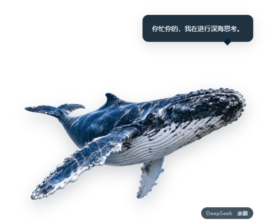
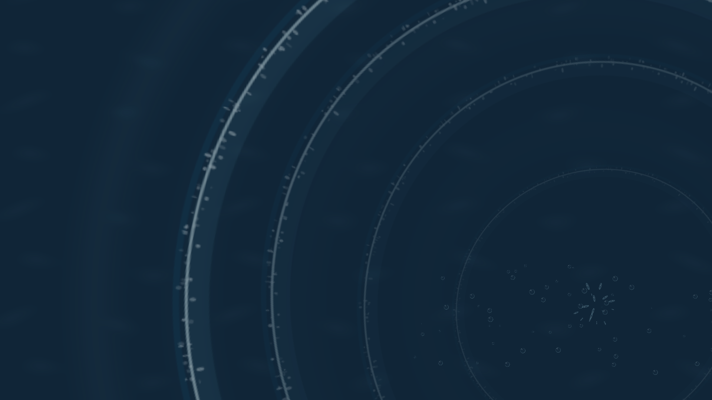

# 写实座头鲸桌宠 · dsh-real-whale-pet

> 一只"真实到像标本"的座头鲸，静静地浮在 Windows 桌面上：它会呼吸、会鲸叫、会冷冷地吐槽你。戳它一下，整块屏幕突然变成水面——水纹、焦散、水花、色散从鲸鱼身上炸开。
>
> **DeepSeek Harness 插件**：Host-only bundle（不声明 `dsh.client`，不改 DSH 页面），由 DSH 的 Cordis 生命周期拉起一个自带的 Electron Helper 子进程来画桌面窗口。
>
> **非官方社区插件**：本项目由社区维护，与 DeepSeek 官方无关。



## 特点

- **桌面级存在感**：透明置顶小窗里浮着一条写实座头鲸，呼吸、漂浮、挤压回弹全部由同一张 PNG 驱动；点击透明区域鼠标穿透到桌面。
- **点击全屏水波**：另一个全屏 overlay 窗口，`focusable:false` + 点击穿透 + `showInactive()`；电影级档位在点击瞬间截屏，用 WebGL 着色器按波场折射，截图只存在内存。
- **本地声音与台词**：20 个离线合成音效（含极稀有气笛）、121 条本地原创台词、连击音阶上涨；音量可在面板滑杆或右键菜单 5%–100% 调节（默认 30%），不调用 LLM。
- **余额与挂件面板**：与 `dsh-whale-widget` 同一取数链路——优先用 DSH 凭据里的 `DEEPSEEK_API_KEY`，没有可用 key 时走 DSH 账号登录态（`deepseekAccount`，充值+赠金合计），**不填 Key 也能直接刷新余额**；也可手动填 Key 覆盖并加密保存。面板还提供幽默 emoji 挂件（男版 `🥚🍆🥚` / 女版 `🌏🌏`），分别贴在鲸鱼身体的对应位置。
- **零侵入**：不抢焦点、不挡全屏视频（overlay 只在效果期间出现）、空闲时接近零开销；托盘常驻，右键菜单可调音量、特效、大小、置顶与隐藏。
- **可替换素材**：`config.jsonc`、`lines.json`、`whale/`、`sfx/`、`fx/` 均可覆盖，配置热重载。



## 安装

### 方式一：DSH Desktop 插件页（本地安装）

1. 打开 DSH 桌面应用的 **Plugins → Add plugin**（DSH 0.2.1 起入口在账户菜单的 Plugins 页）。
2. 输入本仓库的绝对目录（例如 `F:\dsh-real-whale-pet`），或选择交付的 `dsh-real-whale-pet-1.0.0.tgz` 安装包。
3. 按提示确认信任并安装，完全退出并重开 DSH。
4. 桌面右下角出现鲸鱼，系统托盘出现鲸鱼图标。

### 方式二：命令行（其它 DSH profile）

```sh
dsh plugin --profile <profile> add /绝对路径/dsh-real-whale-pet
```

### 方式三：npm（上架后）

```sh
dsh plugin --profile <profile> add dsh-real-whale-pet
```

也可以从 DSH 插件市场（dshmarket）搜索安装。npm 上尚无此包时，请用方式一或二。

## 日常使用

| 操作 | 效果 |
|---|---|
| 点击鲸鱼身体 | 挤压回弹、鲸叫、全屏水波，可能吐槽 |
| 连续点击 | 音阶上涨、水波增强，三连击开始必选连击台词 |
| 拖动鲸鱼 | 移动桌宠，松手后保存位置并显示局部小水波 |
| 点击透明区域 | 鼠标穿透至桌面或下层程序 |
| 右键鲸鱼 / 托盘 | 音量、特效、说话、大小、置顶、隐藏及重载等设置 |
| 点击台词 | 关闭气泡 |
| 点击鲸鱼旁的 DeepSeek 胶囊 / 双击托盘 | 打开余额与挂件面板 |

全屏水波不接收鼠标、不抢焦点，播完后隐藏；其截图只存内存，结束即释放。标准、极简和关闭档不截图。

## 环境

| 项 | 要求 |
|---|---|
| 系统 | Windows 10/11 x64（macOS/Linux 代码路径保留，未实机验收） |
| DSH | 0.2.x（本包在 Desktop `0.2.1-rc.5` 实测；声明 `engines.dsh: >=0.2.0-0 <0.3.0`） |
| Node | >= 22.12.0 |
| Electron | 优先复用 `$DSH_HOME/electron/electron.exe`（本机桌面版通常已有）；缺失时用 `@electron/get` 从 npmmirror 下载，首次需要联网 |

## 数据与配置

默认数据目录 `%USERPROFILE%\.dsh\dsh-real-whale-pet\`（设置 `DSH_HOME` 时随之改变），可从右键菜单直接打开：

| 文件或目录 | 用途 |
|---|---|
| `config.jsonc` | 大小、音量、特效、台词及挂件配置，允许注释与尾逗号 |
| `state.json` | 窗口位置、点击数及台词去重记录 |
| `lines.json` | 可自行编辑的本地台词 |
| `whale/whale-hero.png` | 自定义透明鲸鱼，同名覆盖包内素材 |
| `sfx/*.wav` | 自定义同名音效，覆盖包内合成音效 |
| `fx/*.png` | 可选增强水波素材，缺失时有程序化版本 |
| `logs/helper.log` | Helper 日志，约 2MB 后轮转一份 |
| `deepseek-key.enc` | 系统加密的余额查询密钥，可在面板删除 |

保存配置或台词后约 300ms 生效；替换图片、音效或水波素材后选择托盘"重载配置与素材"。完整说明见 [使用说明](使用说明.md)。

## 隐私

- 默认完全本地运行：不调用 LLM、不联网、不读取 DSH 的对话。
- 余额只在主动点击"刷新余额"时查询：Host 进程按 whale-widget 同款链路，先读 DSH 凭据里的 `DEEPSEEK_API_KEY`，没有则用 DSH 账号登录态（`deepseekAccount` 服务）；结果经只监听 `127.0.0.1`、带随机 token 的桥接交给桌宠进程。手动填写的 Key 用 Electron `safeStorage` 加密后存本机，没有系统加密服务时明确提示，不写明文。
- 截图只存在于内存，动画结束即释放，不写盘、不上传；插件不含遥测。

## 开发

```sh
npm install
npm test                 # 配置、命中、素材白名单、台词和余额测试
npm run check            # 清单、展示元数据、语法及资源完整性
npm start                # 独立启动 Helper
npm run test:electron    # 真实 Electron 回归（有 ffmpeg 时追加全屏视频检查）
npm run test:host        # Cordis 入口与父进程退出检查
npm pack                 # 生成可安装的 tgz
```

安装和日常运行不需要 Python；音效生成（`npm run make:sfx`）与素材整理才需要 Python、numpy、Pillow。

## 目录

```
index.js            ← DSH host 插件（Cordis apply：拉起/守护 Helper）
lib/                ← host 侧模块：electron-path / helper-process / storage
helper/             ← Electron Helper：透明鲸鱼窗、全屏水波、面板、托盘、IPC
assets/             ← 鲸鱼 PNG、水波贴图、20 个音效、台词、默认配置、icon、预览图
locale/             ← 插件页展示用的中英文标题与描述
cordis.patch.yml    ← bundle 挂载声明
scripts/ tests/     ← 检查、素材生成、单元与 Electron 回归
```

## 文档与授权

- [使用说明](使用说明.md)：安装、操作、配置项与待验收范围。
- [验收记录](验收记录.md)：已实测与仍需对应环境验证的项目。
- [设计总纲](设计总纲.md)：最初的完整设计与施工文档（保留作需求依据）。
- [LICENSE](LICENSE)（MIT）、[NOTICE](NOTICE)：代码许可证、第三方来源与素材授权说明。

鲸鱼原图由本仓库作者提供并经一次 AI 去背；水波、音效与台词为本项目原创生成。原图与生成素材的权利不因代码的 MIT 声明而自动改变，转载或再分发素材前请先确认授权。
