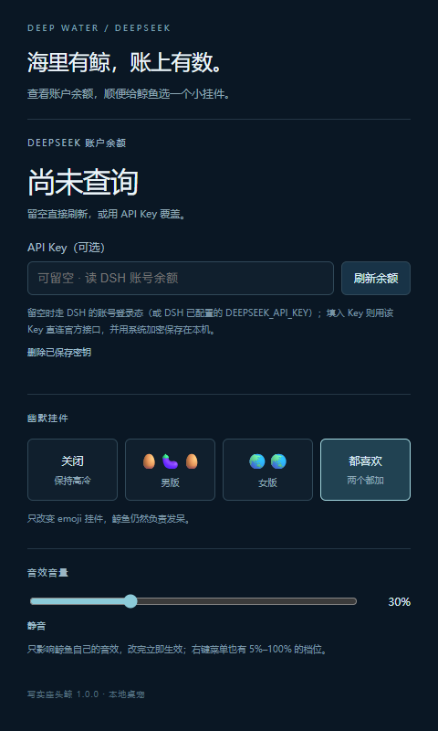
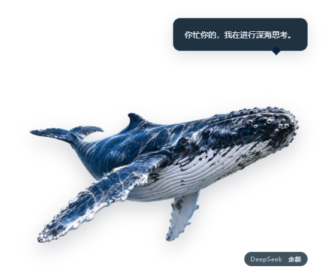

# 写实座头鲸桌宠

本项目已包含可安装的 DSH bundle、独立 Electron Helper、透明鲸鱼、静态水波贴图、20 个原创合成音效和 121 条本地台词。主体只使用一张 PNG，通过呼吸、漂浮和挤压回弹呈现动画；同一张水波贴图叠加、旋转、缩放，气泡和水滴也各复用一张程序化贴图。

## 安装到 DSH

1. 打开 DSH 桌面应用的 **Plugins → Add plugin**。
2. 输入本地目录（例如 `F:\dsh-real-whale-pet`），或选择交付的 `dsh-real-whale-pet-1.0.0.tgz` 安装包；npm 上架后也可以直接填包名 `dsh-real-whale-pet`。
3. 按 DSH 安装界面的提示确认信任并安装，完全退出并重开 DSH。
4. 桌面右下角出现鲸鱼，系统托盘也会出现鲸鱼图标。

插件面向 Windows 10/11，清单允许 DSH 0.2 系列，并显式包含本机 `0.2.1-rc.5` 所在的预发布版本范围。本机已有的 `%USERPROFILE%\.dsh\electron\electron.exe` 会直接复用；其它机器缺少 Electron 时才下载运行时。Mac/Linux 尚未实机验收。

## 日常使用

| 操作 | 效果 |
|---|---|
| 点击鲸鱼身体 | 挤压回弹、鲸叫、全屏水波，可能吐槽 |
| 连续点击 | 音阶上涨、水波增强，三连击开始必选连击台词 |
| 拖动鲸鱼 | 移动桌宠，松手后保存位置并显示局部小水波 |
| 点击透明区域 | 鼠标穿透至桌面或下层程序 |
| 右键鲸鱼 / 托盘 | 音量、特效、说话、大小、置顶、隐藏及重载等设置 |
| 点击台词 | 关闭气泡 |
| 点击鲸鱼旁的 DeepSeek 胶囊 / 双击托盘 | 打开余额与挂件面板 |

全屏水波不接收鼠标、不抢焦点，播完后隐藏；其截图只存内存，结束即释放。标准、极简和关闭档不截图。快速连击会复用已有窗口；已有水波可见时，本次使用透明水波，避免把旧水波再次截入屏幕。

## 余额与幽默挂件

打开面板后**不填 Key 也能直接点“刷新余额”**：取数链路与 `dsh-whale-widget` 一致——

1. 优先用 DSH 凭据里的 `DEEPSEEK_API_KEY`（与 DSH 设置里配置的 key 共用）请求官方 `GET https://api.deepseek.com/user/balance`；
2. 没有可用 key（或 key 调用失败）时，走 **DSH 账号登录态**的 `deepseekAccount.getBalance()`，把充值钱包与赠金钱包合计，不需要去 platform 建 key。

面板也会显示余额、充值余额、赠送余额、**来源（DSH 账号 / API Key）**与更新时间。手动填 API Key 可以覆盖上面的链路：填了就直连官方接口查询，成功后用 Electron 系统安全存储加密保存到本机 `deepseek-key.enc`，下次留空自动使用；“删除已保存密钥”会删除该文件。没有可用的系统加密服务时，会明确提示无法保存，不使用明文代替。

查询只发生在主动点“刷新余额”时，不发起模型调用，不读取 DSH 对话。面板用到的 DSH 服务由 Host 进程访问、经本机回环桥接交给桌宠进程，桥接只监听 `127.0.0.1` 并校验随机 token。

挂件提供“关闭”“男版 `🥚🍆🥚`”“女版 `🌏🌏`”“都喜欢”四种选择，默认关闭。男版贴在鲸鱼腹面后段的对应位置，女版贴在胸鳍后方的胸腹面；两种都选时各自出现在对应位置。修改立即生效并保存供下次启动使用，也可从右键菜单选择。



## 音效音量

默认音量 30%（比最早版本更轻）。两个地方可以调，改完立即生效并保存：

- **余额与挂件面板**的「音效音量」滑杆（0–100%，拖动即生效）和「静音 / 取消静音」按钮；
- **右键鲸鱼或托盘 → 音量**：5% / 10% / 20% / 30% / 50% / 70% / 100% 七档，另有「静音」开关。

音量写入 `config.jsonc` 的 `audio.masterVolume`（0–1）与 `audio.enabled`；长时间不播放时音频上下文会自动挂起，点击或调节后恢复。长鲸叫已单独压低一档，避免突然吓人。

## 配置与素材

默认数据目录：`%USERPROFILE%\.dsh\dsh-real-whale-pet\`，设置 `DSH_HOME` 时随之改变。可从右键菜单直接打开。

| 文件或目录 | 用途 |
|---|---|
| `config.jsonc` | 大小、音量、特效、台词及挂件配置，允许注释与尾逗号 |
| `state.json` | 窗口位置、点击数及台词去重记录 |
| `lines.json` | 可以自行编辑的本地台词 |
| `whale/whale-hero.png` | 自定义透明鲸鱼，同名覆盖包内素材 |
| `sfx/*.wav` | 自定义同名音效，覆盖包内合成音效 |
| `fx/*.png` | 可选增强水波素材，缺失时有程序化版本 |
| `logs/helper.log` | Helper 日志，约 2MB 后轮转一份 |
| `deepseek-key.enc` | 系统加密的余额查询密钥，可在面板删除 |

保存配置或台词后约 300ms 生效。替换图片、音效或水波素材后，选择“重载配置与素材”。正常菜单修改保留 JSONC 注释；配置写坏时继续使用上一次有效配置，提示错误行号。此后从菜单保存设置，会先备份损坏文件，再在有效配置上保存。硬件加速选项需要重启桌宠。

水波增强素材接受这些同名 PNG：`foam-ring`、`caustics-tile`、`water-normal`、`noise-tile`、`splash-crown`、`droplets-tile`、`bubbles-atlas`。皇冠与气泡图集按 4×2 布局读取其中一张静态图，随后只做变形，不播放序列帧。

## 本地启动与开发

```powershell
cd F:\dsh-real-whale-pet
npm install
npm start
```

也可以双击 `scripts\dev-helper.cmd`。开发启动同样使用 DSH 用户数据目录，可通过托盘“退出桌宠”关闭。安装的插件由 DSH 的 Cordis 生命周期拉起并清理 Helper；正常从托盘退出不会触发自动重启，重启 DSH 后恢复。

```powershell
npm test                 # 配置、命中、素材白名单、台词和余额测试
npm run check            # 清单、语法及资源完整性
npm run test:electron    # 真实 Electron 回归；有 ffmpeg 时追加全屏视频检查
npm run test:host        # Cordis 入口与父进程退出检查
npm pack                # 生成可安装的 tgz
```

Windows 沙箱不允许创建目录联接或 GUI 窗口时，需要在普通终端运行相应测试。测试只使用项目内隔离目录，不修改 DSH profile。音效生成需要 Python、numpy；透明素材整理需要 Pillow。安装和日常运行不需要 Python。

`DSH_WHALE_ELECTRON_PATH` 可以指定 Electron；`DSH_WHALE_ELECTRON_VERSION` 可以指定缺失时下载的版本，默认与本机参考插件一致为 `43.3.0`。

## 已验收与待验收

当前实测记录见 [验收记录](验收记录.md)。已执行 Windows Electron 的特效、配置、安全、界面和本地全屏视频检查。余额链路已用本机真实 DSH 凭据实测（key 路返回成功）；DSH 账号登录态路径有单测与桥接回归覆盖，真实账号余额请重启 DSH 后在面板点“刷新余额”确认。多屏混合 DPI、全屏游戏、外部视频播放器和长时间稳定性仍需对应环境实测。

完整初始设计保留在 [设计总纲](设计总纲.md)，来源和许可证见 [NOTICE](NOTICE)。后续新增的余额查询是原先“零联网”约束的明确例外；默认桌宠行为仍完全本地运行。

桌宠与水波预览：




